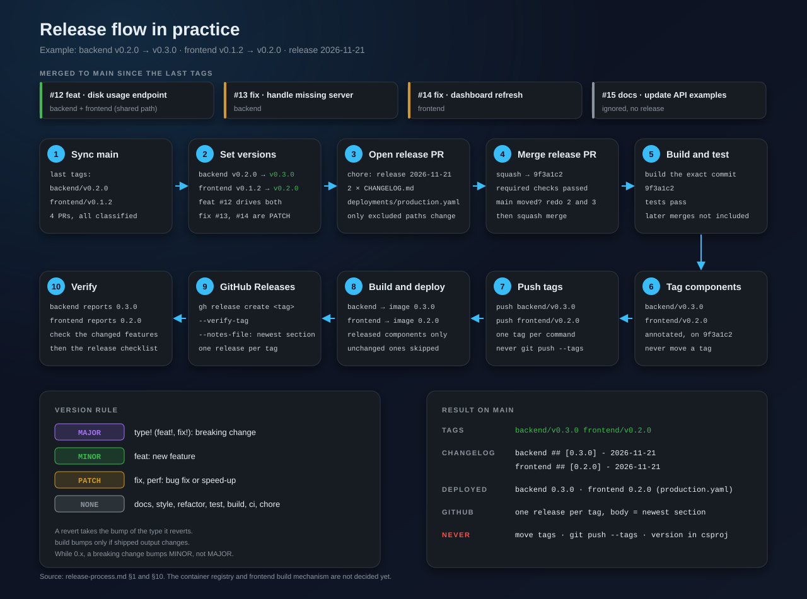

# Release Process

InfraWatch follows a lightweight release process based on [**GitHub Flow**](https://docs.github.com/en/get-started/using-github/github-flow), [**Semantic Versioning**](https://semver.org/), and [**Conventional Commits**](https://www.conventionalcommits.org/en/v1.0.0/). This approach suits a small-to-medium-sized project like InfraWatch, where continuous integration, continuous delivery, and frequent releases are priorities. It keeps the development and release workflow simple without introducing unnecessary branching complexity.

At current time, **Releases** are created manually. There is ***no release automation***. Each component is versioned by its own Git tag.

InfraWatch is a monorepo. Each component (for example `backend` and `frontend`) has its own version, tag, GitHub Release, image, and deployment. A release of one component never changes another component's version.

## 1. Release Flow

A **release event** is one batch of releases. It can release one component, several, or none. The [component map](#41-component-map) decides which changes count for which component.

1. **Sync main and check the component map**

   Pull `main`. For each component, list the files changed since its latest tag. Each file must match a component path, a shared path, or an `ignored` path in [release/components.yml](#41-component-map). If a file matches nothing, stop and add the path to the map through a PR before you continue.

2. **Determine versions per component**

   For each component, apply [Version Priority](#3-version-priority) to the squash-merged PR titles in its window (see [4.1](#41-component-map)). A component with no version-changing title is not released. Record each result as `component: previous → next` or `no release`.

3. **Open a release PR**

   Create a branch `chore/<DeveloperName>/release-YYYY-MM-DD`. Add a new section to each released component's `CHANGELOG.md` ([4.3](#43-changelog)) and update `deployments/<environment>.yaml` ([4.4](#44-deployment-record)). Title the PR `chore: release YYYY-MM-DD`. Its commit changes only excluded or ignored paths, so it never triggers a release.

4. **Merge the release PR**

   Confirm the required checks passed. If a PR that touches a released component's paths merged after step 2, repeat steps 2 and 3 before merging. Squash merge the PR.

5. **Build and test the release commit**

   Pull `main` and find the squash commit of the release PR (see [§5](#5-create-release-tag)). Build and test that exact commit. Later merges are not part of this release.

6. **Create one annotated tag per released component**

   Tag each released component as `<component>/vX.Y.Z` on the release commit.

7. **Push the tags explicitly**

   Push each tag by name. Do not use `git push --tags`.

8. **Build and deploy each released component**

   Build each component from its tag, publish its image, and deploy only that component. Components without a release are not rebuilt or redeployed.

9. **Create GitHub Releases**

   Create one GitHub Release per released tag. Each body is that component's newest section in its `CHANGELOG.md`.

10. **Verify deployments**

    Check that each deployed component reports its released version and that the changed features work.

## 2. Semantic Versioning

InfraWatch uses:

```text
MAJOR.MINOR.PATCH
```

### MAJOR — Breaking Changes

Increment MAJOR when a release introduces backward-incompatible changes.

Example:

```text
1.4.2 → 2.0.0
```

**Typical Breaking Changes**

- Removing or renaming an existing REST API endpoint or configuration key.
- Changing an endpoint's request or response contract in a way that breaks existing callers.
- Changing a configuration key's meaning, type, or default in a way that breaks existing configurations.

**Versioning Rules**

- When creating a Pull Request, indicate a breaking change by placing `!` immediately after the PR type or scope in the PR title (e.g., `feat!:` or `feat(api)!:`). The release process uses this marker to identify breaking changes. A `BREAKING CHANGE:` footer in a commit message alone does not trigger a MAJOR version bump (see [Deviations from the Specifications](#deviations-from-the-specifications)).
- While the project is in the `0.x` version range, breaking changes increment MINOR instead of MAJOR.

> **⚠️ Pay Attention**
>
> At present, 21 November 2026, InfraWatch is still in its initial setup phase. Our current focus is on establishing the core infrastructure and foundational components before moving on to business feature development.
>
> Keep in mind that `1.0.0` represents an important milestone for the project: the completion of its initial setup. By that point, we expect the foundational infrastructure to be in place, the REST API endpoints and configuration keys to be stable, and the project to be ready for business feature development.
>
> Until we reach this milestone, InfraWatch will remain in the `0.x` version range.


---

### MINOR — New Features

Increment when the release contains new functionality in a backward-compatible manner.

- A `feat` PR title triggers a **MINOR** version.
- A `revert` of a `feat` PR triggers a **MINOR** version.
- Multiple `feat` PRs can be included in the same release.
- The release receives **one MINOR version increment**.

Example:

```text
feat: add disk usage endpoint
feat: add memory usage endpoint
feat: add health check
```

Release:

```text
1.4.2 → 1.5.0
```

---

### PATCH — Backward-Compatible Fixes and Improvements

Increment when the release contains backward-compatible changes that correct or improve existing behavior without adding functionality.

**Versioning Rules**

- A `fix` or `perf` PR title triggers a **PATCH** version.
- `revert` takes the reverted type's level: reverting a `fix` or `perf` is PATCH, and reverting a `feat` is MINOR. A revert of a breaking `feat!` takes the MAJOR level, which is MINOR while we are in `0.x`.
- `docs`, `style`, `refactor`, `test`, `ci`, and `chore` do not trigger a PATCH version.
- `build` does not trigger a version bump when the change only affects build tooling or configuration. If a build-related change fixes a defect, improves performance, or introduces new functionality in the shipped application, use `fix`, `perf`, or `feat` respectively.

Example:

```text
fix: handle missing server
fix(build): fix missing dependency in release package
perf(build): optimize application startup through build configuration
```

Release:

```text
1.4.2 → 1.4.3
```

### Deviations from the specifications

This team follows [SemVer 2.0.0](https://semver.org/) and [Conventional Commits 1.0.0](https://www.conventionalcommits.org/en/v1.0.0/) except for these points:

- **Breaking footer:** a `BREAKING CHANGE:` footer does not trigger MAJOR. Only `!` in the PR title does, because squash merge can drop footers. Conventional Commits requires MAJOR for the footer.
- **Deprecation:** a deprecation does not bump MINOR by itself. SemVer rule 7 requires a MINOR bump. Record each deprecation with the `DEPRECATED:` footer (see [Commit Convention](git-commit-convention.md#6-footer-optional)).
- **PATCH types:** `perf` is PATCH by team decision. SemVer rule 6 limits PATCH to bug fixes.

## 3. Version Priority

Versioning is per component. A component's release window is the squash-merged PRs on `main` that changed its files (see [4.1](#41-component-map)) since its previous tag. Only PR titles drive versioning. Commit footers are not used, because squash merging may not keep them.

For each component, the next version is its previous tag plus the highest bump found in its window:

```text
MAJOR   `!` in a PR title, or a `revert` of one (MINOR while the version is 0.x)
  │
MINOR   any `feat`, or a `revert` of a `feat`
  │
PATCH   any `fix` or `perf`, or a `revert` of one of them
  │
none    only docs, style, refactor, test, build, ci, or chore
```

Rules:

- Several PRs at the same level are able to give one increment. For example, three `feat` PRs give one MINOR bump.
- Create one tag per released component, named `<component>/vMAJOR.MINOR.PATCH` (for example `backend/v1.5.0`). The `v` is a tag prefix, not part of the version. Component names are defined in [4.1](#41-component-map).
- Never move or delete a published tag. If a release is wrong, publish a new version instead. Protecting `*/v*` tags with a GitHub tag ruleset is recommended; a repository admin sets it.
- The first release of a component is `<component>/v0.1.0`. With no previous tag, tag a chosen commit on `main` (see [First release](#first-release)).
- Accepted edge case: Reverting a `feat` results in a MINOR version bump. Reverting a breaking feature (`feat!`) must also be marked as a breaking change (`revert!`) and results in a MAJOR version bump. Document this behavior in the component's changelog.
- A breaking change (`!` in the title) gives MAJOR, even when the window also contains other types.

Examples:

```text
feat + fix                → MINOR
fix + docs + refactor     → PATCH
fix + revert of a fix     → PATCH
revert of a feat          → MINOR
feat! (while 0.x)         → MINOR
feat! (from 1.0.0 on)     → MAJOR
docs + chore              → no release
```


## 4. Release Preparation

Before a release event:

- Confirm all intended PRs are merged into `main`.
- Confirm the required checks passed on `main`.
- Confirm `release/components.yml` covers every changed file (see [4.1](#41-component-map)).
- Review the PR titles in each component's window, using [Version Priority](#3-version-priority).
- Determine each component's next version.

Releases are tagged on `main`. InfraWatch does not use release branches at current time.


### 4.1 Component Map

The map is `release/components.yml`. It says which files belong to which component, and which shared paths affect which components. Paths are placeholders until the component projects exist.

```yaml
components:
  - name: backend
    tag_prefix: backend
    paths:
      - src/backend/
    exclude:
      - src/backend/tests/
      - src/backend/CHANGELOG.md
  - name: frontend
    tag_prefix: frontend
    paths:
      - src/frontend/
    exclude:
      - src/frontend/CHANGELOG.md
shared:
  - path: src/shared/api-contracts/
    affects: [backend, frontend]
ignored:
  - docs/
  - tests/
  - release/
  - deployments/
```

Each changed file is classified in this order:

1. A file under a component's `exclude` is ignored (for example, backend tests do not ship, and a component's `CHANGELOG.md` is a record, not a shipped change).
2. A file under a component's `paths` belongs to that component.
3. A file under a `shared` path affects every component in its `affects` list.
4. A file under `ignored` is ignored.
5. A file that matches nothing stops the release. Add its path to the map through a PR first.

A shared path that affects no component goes under `ignored`. A PR counts toward a component's window only if it changes a file that affects that component. A PR that touches only excluded or ignored paths never triggers a release.

### 4.2 Version Source

- The tag `<component>/vX.Y.Z` is the only version record for that component. The component's `CHANGELOG.md` records what changed in each version, but it does not set the version.
- `.csproj` and `package.json` files do not carry version fields, and the release process does not write them. Builds inject the version from the tag:
  - Backend: `dotnet publish -p:Version=X.Y.Z`.
  - Frontend: the build receives `X.Y.Z` from the tag `frontend/vX.Y.Z`. The exact mechanism depends on the frontend tooling, which is not chosen yet.
- Images are tagged `<registry>/infrawatch-<component>:X.Y.Z` (no `v`). The registry is not decided yet.

### 4.3 Changelog

Each component has its own `CHANGELOG.md` at the root of its project, for example `src/backend/CHANGELOG.md`. Each released version adds one section at the top of that file, below the title. Older sections stay below it.

```markdown
# Changelog

## [0.3.0] - 2026-11-21

### Features
- feat: add disk usage endpoint (#12)

### Bug Fixes
- fix: handle missing server (#13)
```

- The heading is `## [X.Y.Z] - YYYY-MM-DD`, using the version from the tag and the release date. The `v` is not part of the heading. This follows [Keep a Changelog](https://keepachangelog.com/en/1.1.0/).
- Group entries in this order: Breaking Changes, Features, Bug Fixes, Performance Improvements, Other.
- Each entry is a squash-merged PR title with its PR number.
- A PR that touches two components appears in both changelogs.
- A revert appears under the group of the type it reverts.
- Components without a release get no new section.
- Build the entries from the path-filtered `git log` for each component (see [§10](#10-release-walkthrough)). The log excludes the component's `CHANGELOG.md`, so earlier release PRs do not appear as entries.
- The changelog is written in the release PR, so it is part of the tagged commit. Its GitHub Release body is the newest section (see [§5](#5-create-release-tag)).

### 4.4 Deployment Record

`deployments/<environment>.yaml` records what runs in each environment:

```yaml
environment: production
components:
  backend: 0.3.0
  frontend: 0.2.0
```

Versions have no `v` prefix. Update only released components in the release PR. Components without a release keep their current value.

## 5. Create Release Tag

Each released component gets one annotated tag, placed on the release commit. The release commit is the squash commit of the release PR on `main`.

Tag format:

```text
<component>/v<MAJOR>.<MINOR>.<PATCH>
```

Examples:

```text
backend/v0.1.0
backend/v0.3.0
frontend/v0.2.0
```

Find the release commit after the release PR merges:

```bash
gh pr view <number> --json mergeCommit --jq .mergeCommit.oid
```

Create one annotated tag per released component on the built and tested release commit. Never reuse a tag name:

```bash
git tag -a backend/v1.5.0 -m "backend v1.5.0" <release-commit>
```

Push each tag by name. Never use `git push --tags`, and never move or reuse a pushed tag:

```bash
git push origin backend/v1.5.0
git push origin frontend/v1.2.0
```

Create one GitHub release per tag. Its body is the newest section of that component's `CHANGELOG.md`. This requires `gh` to be authenticated (`gh auth login`). Run the `awk` command in Git Bash or WSL. It prints from the first `## ` heading up to the next one:

```bash
awk '/^## /{if(c++)exit} c' src/backend/CHANGELOG.md > notes-backend.md
gh release create backend/v1.5.0 --verify-tag --title "backend v1.5.0" --notes-file notes-backend.md
rm notes-backend.md
```

## 6. Deployment

There is no deployment pipeline yet, so deployment is manual. Once a pipeline is defined, update this section.

Deploy each released component on its own. Components without a release are not rebuilt or redeployed.

```text
Build and test (release commit)
     │
     ▼
   Tag per component  →  Deploy released components  →  Verify
```

Record each deployed version in `deployments/<environment>.yaml` in the release PR (see [4.4](#44-deployment-record)).

Rollback: revert the PR on `main`, then release a new tag for each affected component at the bump that revert gives (see [Version Priority](#3-version-priority)). Do not move the old tags.

The deployment steps depend on the project's infrastructure. Record them here once they are defined.

## 7. Hotfix Release

For an urgent production bug:

1. Release any unreleased commits already on `main` first, so the hotfix ships only its own fix.
2. Branch `fix/<DeveloperName>/<description>` from `main`.
3. Open a PR. It needs 1 approval and the required checks.
4. Squash merge the PR into `main`.
5. Release a PATCH for the affected component only, following the [Release Flow](#1-release-flow).

Example:

```text
Current backend version: 0.3.0 (backend/v0.3.0)

fix: handle invalid server id

New backend version: 0.3.1 (backend/v0.3.1). The frontend is not released.
```

## 8. Release Checklist

```text
[ ] All intended PRs merged into main
[ ] Required checks passed on main
[ ] release/components.yml covers every changed file
[ ] PR titles reviewed per component
[ ] Version determined per component (MAJOR / MINOR / PATCH / none)
[ ] Release PR merged (CHANGELOG.md sections and deployments/<environment>.yaml updated)
[ ] Release commit built and tested
[ ] One annotated tag per released component (<component>/vX.Y.Z)
[ ] Tags pushed explicitly by name (git push origin <tag> ...)
[ ] Each released component built and deployed
[ ] One GitHub release per tag (gh release create <tag> --verify-tag --notes-file ...)
[ ] Deployments verified
```

## 9. Release Rules

```text
!  in PR title → MAJOR (MINOR while 0.x)
feat           → MINOR
fix, perf      → PATCH
revert         → same level as the type it reverts
other types    → no automatic version bump
```

**Important:** Each component's version is determined from the **changes that touch that component** (see [4.1](#41-component-map)), not from the number of commits. Multiple `feat` commits can produce a single MINOR version increment for that component.

### Version Impact based on Commit Types

The type list is defined in [Commit Types](git-commit-convention.md#2-commit-types).

| **Type**   | **Version impact**                                                    |
| ---------- | --------------------------------------------------------------------- |
| `feat`     | Minor bump                                                            |
| `fix`      | Patch bump                                                            |
| `perf`     | Patch bump                                                            |
| `docs`     | No bump                                                               |
| `style`    | No bump                                                               |
| `refactor` | No bump                                                               |
| `test`     | No bump                                                               |
| `build`    | No bump, unless shipped output changes (then title it `fix`, `perf`, or `feat`) |
| `ci`       | No bump                                                               |
| `chore`    | No bump                                                               |
| `revert`   | Same as the reverted type (`revert: feat` is minor, `revert: fix` is patch, `revert!: feat!` is major) |

`feat` and `fix` come from the Conventional Commits specification. The other types are defined by this repository. A `revert` takes the bump of the type it reverts. Its PR title names that type, for example `revert: feat(...)`. If the reverted commit is breaking, the title also gets `!` after `revert`, for example `revert!: feat!: ...`. See [Revert Commit](git-commit-convention.md#8-revert-commit) for the format.

## 10. Release Walkthrough

This section walks through one release event using the steps in [Release Flow](#1-release-flow). The paths, PR numbers, and file names are examples. Replace them with real ones.

**Scenario:** The latest tags are `backend/v0.2.0` and `frontend/v0.1.2`. These PRs were squash-merged into `main` since then:

| PR | Title | Files changed |
| --- | --- | --- |
| #12 | `feat: add disk usage endpoint` | `src/backend/` and `src/shared/api-contracts/` |
| #13 | `fix: handle missing server` | `src/backend/` |
| #14 | `fix: keep dashboard refresh running` | `src/frontend/` |
| #15 | `docs: update API examples` | `docs/` only |

Expected result: backend `v0.3.0` (MINOR, from #12) and frontend `v0.2.0` (MINOR, because #12 changed a shared path that affects frontend).

### Step 1: Sync main and check the component map

```bash
git fetch --tags origin
git switch main
git pull --ff-only origin main
git describe --tags --match "backend/v*" --abbrev=0
git describe --tags --match "frontend/v*" --abbrev=0
```

Expected output: `backend/v0.2.0` and `frontend/v0.1.2`. Use `--match` so each command finds only that component's tag. If `git describe` fails with "No names found", the component has no previous tag. Use the [First release](#first-release) path below.

List the changed files and check each one against [release/components.yml](#41-component-map):

```bash
git diff --name-only backend/v0.2.0..origin/main
git diff --name-only frontend/v0.1.2..origin/main
```

Example output (from the first command):

```text
src/backend/Services/DiskUsageService.cs
src/shared/api-contracts/disk-usage.ts
src/frontend/src/pages/Dashboard.tsx
docs/api-examples.md
```

These classify as: backend, shared (backend and frontend), frontend, and ignored. Every file must classify. If one does not, stop and add its path to the map through a PR.

### Step 2: Determine the version for each component

List each component's window with path filters. The filters are the component's paths and the shared paths:

```bash
git log --no-merges --oneline backend/v0.2.0..origin/main -- src/backend/ ':(exclude)src/backend/tests/' ':(exclude)src/backend/CHANGELOG.md' src/shared/api-contracts/
git log --no-merges --oneline frontend/v0.1.2..origin/main -- src/frontend/ ':(exclude)src/frontend/CHANGELOG.md' src/shared/api-contracts/
```

Example output for backend:

```text
e4f5a6b fix: handle missing server (#13)
c7d8e9f feat: add disk usage endpoint (#12)
```

Example output for frontend:

```text
b2c3d4e fix: keep dashboard refresh running (#14)
c7d8e9f feat: add disk usage endpoint (#12)
```

PR #15 appears in neither list, because it changed only ignored paths. Apply [Version Priority](#3-version-priority) to each list:

- Backend: `feat` is present, so the bump is MINOR. `backend/v0.2.0` → `backend/v0.3.0`.
- Frontend: `feat` (through the shared path) is present, so the bump is MINOR. `frontend/v0.1.2` → `frontend/v0.2.0`.

Each `fix` is a PATCH, but the MINOR bump from `feat` is higher, so it does not add to the result.

Other windows give different results:

| Changes in the window | Backend | Frontend |
| --- | --- | --- |
| Only `fix: handle missing server` (#13) | PATCH: `v0.2.1` | no release |
| Only `docs: update API examples` (#15) | no release | no release |
| `feat` that changes `src/shared/api-contracts/` (#12) | MINOR: `v0.3.0` | MINOR: `v0.2.0` |
| A file that matches no path, for example `scripts/seed.ps1` | release stops | release stops |

For the last row, the release stops at step 1. Add the path to `release/components.yml` through a PR, then start again.

### Step 3: Open the release PR

Create a branch, then write the files the release PR changes:

```bash
git switch -c chore/AnhNguyen/release-2026-11-21
```

`src/backend/CHANGELOG.md` and `src/frontend/CHANGELOG.md`, each with a new section at the top, built from the two logs in step 2 (see [4.3](#43-changelog)). The changelog is written in the release PR, so the tagged commit includes it:

```markdown
# Changelog

## [0.3.0] - 2026-11-21

### Features
- feat: add disk usage endpoint (#12)

### Bug Fixes
- fix: handle missing server (#13)
```

```markdown
# Changelog

## [0.2.0] - 2026-11-21

### Features
- feat: add disk usage endpoint (#12)

### Bug Fixes
- fix: keep dashboard refresh running (#14)
```

`deployments/production.yaml` (see [4.4](#44-deployment-record)):

```yaml
environment: production
components:
  backend: 0.3.0
  frontend: 0.2.0
```

Commit, push, and open the PR:

```bash
git add src/backend/CHANGELOG.md src/frontend/CHANGELOG.md deployments/production.yaml
git commit -m "chore: release 2026-11-21"
git push -u origin HEAD
gh pr create --title "chore: release 2026-11-21" --fill
```

The release PR changes only excluded or ignored paths, so it does not count toward any window and does not trigger a release.

### Step 4: Merge the release PR

Confirm the required checks passed on the release PR. If a PR that changes a released component's files merged after step 2, redo steps 2 and 3 before merging, so the changelogs and deployment record match `main`. Then squash merge the PR. [Repository Settings](git-convention-tools.md#4-repository-settings-recommended) describes the solo maintainer bypass.

```bash
gh pr merge 16 --squash --delete-branch
gh pr view 16 --json mergeCommit --jq .mergeCommit.oid
```

The second command prints the release commit SHA. Use that SHA for the rest of the steps.

### Step 5: Build and test the release commit

```bash
git fetch origin main
git switch --detach <release-commit>
```

Build and test that commit with the project's build and test commands. Commits merged after the release PR are not part of this release.

### Step 6: Create one annotated tag per released component

Tag the release commit from step 4, once for each released component:

```bash
git tag -a backend/v0.3.0 -m "backend v0.3.0" <release-commit>
git tag -a frontend/v0.2.0 -m "frontend v0.2.0" <release-commit>
git show --no-patch backend/v0.3.0
```

Never reuse a tag name. Check each tag points at the release commit.

### Step 7: Push each tag by name

```bash
git push origin backend/v0.3.0
git push origin frontend/v0.2.0
```

Do not use `git push --tags`, because it pushes every local tag.

### Step 8: Build and deploy each released component

Deploy only the released components. Build each one from its own tag:

- Backend: `git switch --detach backend/v0.3.0`, then `dotnet publish -p:Version=0.3.0`. The project path is a placeholder. Publish the image as `<registry>/infrawatch-backend:0.3.0`.
- Frontend: `git switch --detach frontend/v0.2.0`, then build with the version from the tag. Publish the image as `<registry>/infrawatch-frontend:0.2.0`.

The registry is not decided yet. The deployment steps depend on the infrastructure. See [Deployment](#6-deployment).

### Step 9: Create one GitHub Release per tag

Each release body is the newest section of that component's `CHANGELOG.md`. Extract each section with `awk` in Git Bash or WSL, then create the release:

```bash
awk '/^## /{if(c++)exit} c' src/backend/CHANGELOG.md > notes-backend.md
gh release create backend/v0.3.0 --verify-tag --title "backend v0.3.0" --notes-file notes-backend.md
rm notes-backend.md

awk '/^## /{if(c++)exit} c' src/frontend/CHANGELOG.md > notes-frontend.md
gh release create frontend/v0.2.0 --verify-tag --title "frontend v0.2.0" --notes-file notes-frontend.md
rm notes-frontend.md
```

`--verify-tag` aborts if the tag is not on the remote, so run step 7 first. This needs `gh` to be authenticated (`gh auth status`).

### Step 10: Verify each deployment

Check that the deployed backend reports `0.3.0` and the deployed frontend reports `0.2.0`. Check that the changed features work: the disk usage endpoint and the dashboard refresh. Then go through the [Release Checklist](#8-release-checklist).

### First release

A component with no previous tag (for example, a new `frontend` project) follows the same steps, with three differences:

- Step 1: `git describe` fails, so there is no previous tag. The window is the full path-filtered history:

  ```bash
  git log --no-merges --oneline -- src/frontend/ ':(exclude)src/frontend/CHANGELOG.md' src/shared/api-contracts/
  ```

- Step 2: the first release is `<component>/v0.1.0`, whatever the PR titles say.
- Step 6: tag it with `frontend/v0.1.0`. Use the commit from step 4, which is the release PR's squash commit.

### If a release is wrong

Do not move or delete the tag. Revert the PR on `main` and release the next version. For example, to undo `feat: add disk usage endpoint (#12)`, open a revert PR titled `revert: feat: add disk usage endpoint`. The title format is in [Commit Convention §8](git-commit-convention.md#8-revert-commit). The reverted PR changed `src/backend/` and the shared path, so both components get a bump:

- Backend: `v0.3.0` → `v0.4.0` (MINOR, because a `feat` is reverted).
- Frontend: `v0.2.0` → `v0.3.0` (MINOR, because the shared path affects frontend).

Run steps 1 to 10 again for the revert PR. Its changelog lists the revert under the Features group, because that is the type it reverts (see [4.3](#43-changelog)).

### Common mistakes

- Using `git describe` without `--match`. It can return another component's tag.
- Using `git push --tags`, which pushes every local tag.
- Tagging a commit that was not built and tested.
- Creating the GitHub release before the tag is pushed. `--verify-tag` aborts in that case.
- Moving a tag after it was pushed. Publish a new version instead.
- Writing a version into `.csproj` or `package.json`. The release process does not do this; builds inject the version from the tag.
- Using `--generate-notes` for a component. It cannot filter by path, so it includes PRs from the other component too.
- Skipping `deployments/production.yaml` in the release PR, so the deployment record is out of date.

## 11. Release Flow at a Glance

This diagram follows the example in §10: backend `v0.2.0` → `v0.3.0`, frontend `v0.1.2` → `v0.2.0`, released on 2026-11-21. Use it as a quick overview. The steps above are the authoritative rules.




